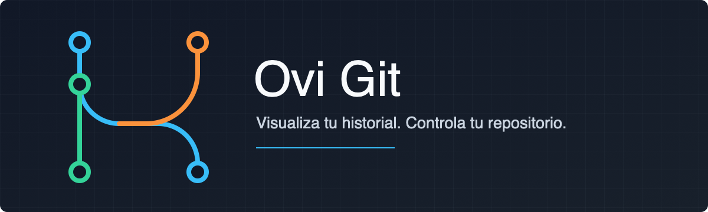
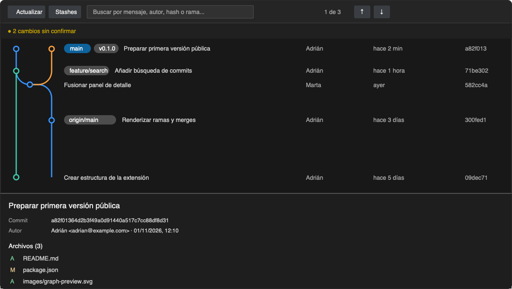

<div align="center">
  
</div>

# Ovi Git

Visualiza el historial de Git y trabaja con ramas, commits, etiquetas y stashes sin salir de Visual Studio Code.

Ovi Git convierte el historial de cualquier repositorio del espacio de trabajo en un gráfico compacto e interactivo. La extensión utiliza tu instalación local de Git: no envía el contenido del repositorio a servicios externos.

<div align="center">
  
</div>

## Características

- Vista propia en la barra de actividad para trabajar sin abandonar el editor.
- Selector de repositorio, rama actual y cambios locales en un único panel.
- Creación y cambio de ramas con controles directos.
- Comparación de ramas con la lista de archivos modificados y acceso al diff.
- Creación de commits con todos los cambios desde el panel lateral.
- Historial gráfico con ramas, merges y posición actual de `HEAD`.
- Referencias locales, remotas y etiquetas junto a cada commit.
- Búsqueda por mensaje, autor, correo, hash o nombre de rama.
- Panel de detalle con autor, fecha, cuerpo del commit y archivos modificados.
- Comparación de cada archivo con su versión anterior mediante el visor diff de VS Code.
- Indicador de cambios sin confirmar y acceso rápido a Control de código fuente.
- Historial paginado para trabajar con repositorios grandes.

## Operaciones Git

| Elemento        | Acciones disponibles                                                               |
| --------------- | ---------------------------------------------------------------------------------- |
| Commit          | Crear rama o etiqueta, checkout separado, cherry-pick, revert, reset y copiar hash |
| Rama local      | Checkout, merge, crear rama, eliminar y copiar nombre                              |
| Rama remota     | Crear rama local, merge, eliminar del remoto y copiar nombre                       |
| Etiqueta        | Eliminar y copiar nombre                                                           |
| Stash           | Aplicar, pop, crear rama y eliminar                                                |
| Cambios locales | Guardar en stash o abrir Control de código fuente                                  |

Las operaciones destructivas solicitan confirmación antes de ejecutarse.

## Uso

1. Abre en VS Code una carpeta que pertenezca a un repositorio Git.
2. Selecciona el icono de Ovi Git en la barra de actividad.
3. Consulta los cambios locales, crea una rama o escribe el mensaje para confirmar todos los cambios.
4. Selecciona una rama para comparar sus archivos con la rama actual.
5. Pulsa **Abrir gráfico** para explorar el historial completo y consultar los detalles de cada commit.

También puedes ejecutar **Ovi Git: Abrir gráfico** desde la paleta de comandos o usar el botón situado en el encabezado de Control de código fuente.

## Instalación desde un VSIX

Genera el paquete instalable:

```bash
npm install
npx @vscode/vsce package
```

Después, abre **Extensiones**, selecciona el menú `...`, elige **Instalar desde VSIX...** y abre el archivo `ovi-git-*.vsix` generado.

## Requisitos

- Visual Studio Code 1.85 o posterior.
- Git 2.23 o posterior disponible en `PATH`.
- Una carpeta de trabajo que pertenezca a un repositorio Git.

## Desarrollo

```bash
npm install
npm run compile
```

Pulsa `F5` y selecciona **Ejecutar extensión** para abrir una ventana de Extension Development Host. Durante el desarrollo puedes mantener activa la compilación incremental:

```bash
npm run watch
```

## Publicación

El Marketplace no permite publicar dos veces la misma versión: **cada publicación necesita una versión nueva** en `package.json`.

### ¿Qué versión subir?

La versión sigue el formato `MAYOR.MENOR.PARCHE` (por ejemplo, `0.2.2`).

| Tipo de cambio                                        | Comando                          | Ejemplo       |
| ----------------------------------------------------- | -------------------------------- | ------------- |
| Corrección de errores, textos, iconos o documentación | `npx @vscode/vsce publish patch` | 0.2.2 → 0.2.3 |
| Nueva funcionalidad compatible con lo anterior        | `npx @vscode/vsce publish minor` | 0.2.2 → 0.3.0 |
| Cambio incompatible o rediseño importante             | `npx @vscode/vsce publish major` | 0.2.2 → 1.0.0 |
| La versión ya se subió pero la publicación falló      | `npx @vscode/vsce publish`       | 0.2.2 → 0.2.2 |

`publish patch|minor|major` actualiza `package.json`, crea un commit y una etiqueta (`v0.2.3`) y publica. Requiere que no haya cambios sin confirmar.

### Flujo habitual

```bash
git add -A
git commit -m "Descripción del cambio"
npx @vscode/vsce publish patch
git push origin main --follow-tags
```

### Referencia rápida

| Tarea                                        | Comando                              |
| -------------------------------------------- | ------------------------------------ |
| Instalar dependencias                        | `npm install`                        |
| Compilar                                     | `npm run compile`                    |
| Compilar en modo observación                 | `npm run watch`                      |
| Generar el `.vsix` para probar localmente    | `npx @vscode/vsce package`           |
| Iniciar sesión en el Marketplace (una vez)   | `npx @vscode/vsce login ovi-dev`     |
| Publicar subiendo versión                    | `npx @vscode/vsce publish patch`     |
| Publicar sin subir versión                   | `npx @vscode/vsce publish`           |
| Subir commits y etiquetas a GitHub           | `git push origin main --follow-tags` |
| Ver cambios pendientes                       | `git status`                         |
| Ver últimas versiones publicadas (etiquetas) | `git tag --sort=-v:refname`          |

> El login pide un token de Azure DevOps con el permiso **Marketplace → Manage**. Si caduca, vuelve a ejecutar `npx @vscode/vsce login ovi-dev`.

## Privacidad

Ovi Git ejecuta el binario local de Git con las credenciales y la configuración de tu equipo. La extensión no incluye telemetría y no transmite el historial ni los archivos del repositorio.

## Licencia

Publicado bajo la [licencia MIT](LICENSE).
